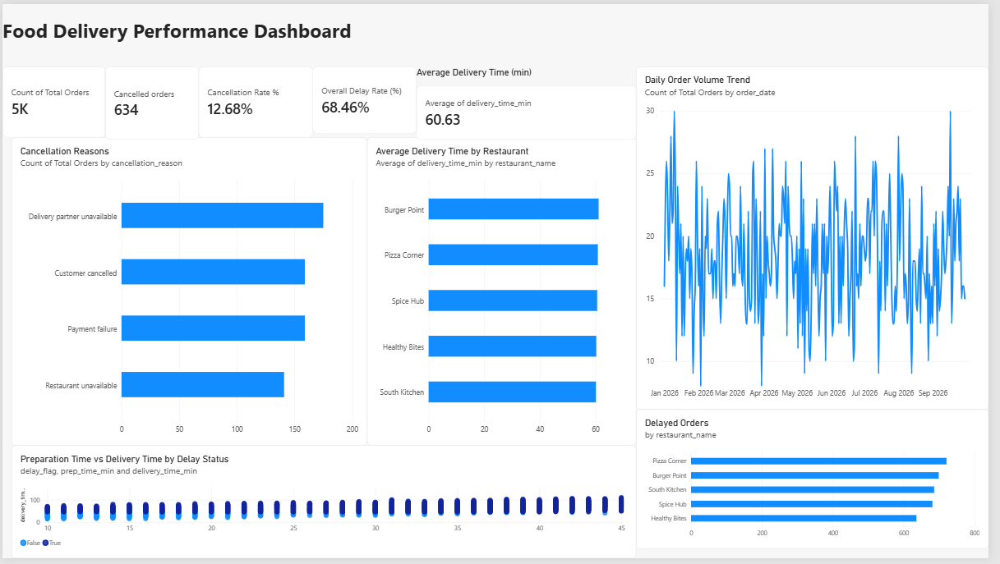

# Food Delivery Analytics & Root-Cause Intelligence

An end-to-end data analytics project that analyzes food delivery orders to uncover cancellation patterns, delivery delays, restaurant performance, and city-level operational issues using Python, SQL, PostgreSQL, and Power BI.



## Project Overview

Food delivery platforms need to understand why orders get cancelled, which restaurants experience delivery delays, and which cities require operational improvements.

This project analyzes **5,000 food delivery orders** to turn raw order data into actionable business insights through data processing, SQL analysis, Python visualizations, and an interactive Power BI dashboard.

## Key Metrics

| Metric | Result |
|---|---:|
| Total orders | 5,000 |
| Delivered orders | 4,366 |
| Cancelled orders | 634 |
| Cancellation rate | 12.68% |
| Average delivery time | 60.63 minutes |
| Dashboard overall delay rate | 68.46% |

*Note: Delay-rate figures depend on the denominator used. The dashboard's overall delay rate uses all orders, while the restaurant-level SQL analysis calculates delayed orders as a percentage of delivered orders.*

## Business Questions

- What percentage of orders are cancelled?
- Which cities have the highest cancellation rates?
- What are the leading reasons for cancellations?
- Which restaurants have the highest delivery delay rates?
- What is the average delivery time?
- Which operational improvements should be prioritized?

## Dashboard Preview

The Power BI dashboard summarizes order volume, cancellations, delivery delays, and delivery performance.


## Key Business Insights

### 1. Cancellation patterns

- 634 of 5,000 orders were cancelled, representing a cancellation rate of **12.68%**.
- Delivery partner unavailability was the largest cancellation category, accounting for **27.60%** of cancellations.
- Payment failure and customer cancellation each accounted for **25.08%**.
- Restaurant unavailability accounted for **22.24%**.

### 2. City-level performance

| City | Orders | Cancelled | Cancellation rate |
|---|---:|---:|---:|
| Bhopal | 1,242 | 189 | 15.22% |
| Indore | 1,263 | 180 | 14.25% |
| Bengaluru | 1,214 | 134 | 11.04% |
| Pune | 1,281 | 131 | 10.23% |

Bhopal has the highest cancellation rate among the four cities, making it a priority for further investigation.

### 3. Restaurant delivery performance

The SQL analysis compares restaurants using order volume, delivered orders, delay rate, and average delivery time.

The leading displayed delay rates include:

- Burger Point: **80.62%**
- Spice Hub: **78.64%**
- Pizza Corner: **78.20%**

These figures are calculated among delivered orders. They can help identify restaurants for a deeper review of preparation time, delivery-partner availability, and delivery operations.

## Recommended Business Actions

- **Improve delivery-partner availability:** Investigate staffing and partner allocation during high-demand periods.
- **Reduce payment failures:** Review payment errors and checkout failures.
- **Investigate city-level cancellations:** Start with Bhopal and compare cancellation patterns by time, restaurant, and reason.
- **Review restaurant delays:** Compare preparation time and delivery time to distinguish restaurant-side and delivery-side bottlenecks.
- **Monitor operational KPIs:** Track cancellation rate, delay rate, and average delivery time regularly.

These are recommendations based on the observed patterns; further investigation would be required to establish the underlying causes.

## Tech Stack

- **Python:** Pandas, NumPy, Matplotlib
- **Database:** PostgreSQL, SQL
- **Business Intelligence:** Microsoft Power BI
- **Data Analysis:** Data cleaning, exploratory data analysis, aggregations, KPI reporting, root-cause investigation
- **Tools:** Git, GitHub, VS Code

## Project Structure

```text
food-delivery-analytics/
├── data/
│   ├── raw/
│   │   └── food_delivery_orders.csv
│   └── processed/
│       ├── cancellation_reasons.csv
│       ├── city_cancellation_analysis.csv
│       └── restaurant_performance.csv
├── notebooks/
│   ├── generate_data.py
│   ├── load_data.py
│   ├── analyze_data.py
│   └── visualize_data.py
├── powerbi/
│   └── screenshots/
│       └── food_delivery_dashboard.png
├── reports/
│   ├── business_insights.md
│   └── charts/
├── sql/
│   └── 02_root_cause_analysis.sql
├── Food_Delivery_Analytics.pbix
├── requirements.txt
└── README.md
```

## Limitations

- The dataset is synthetic and is intended for portfolio demonstration, not as evidence of real-world platform performance.
- Observed relationships indicate where to investigate; they do not independently prove the cause of a delay or cancellation.
- KPI definitions and denominators should remain consistent when comparing the Python, SQL, and Power BI results.

## Future Improvements

- Automate data refresh and KPI reporting.
- Add date and time-based operational trend analysis.
- Build an interactive web dashboard for exploring order-level insights.
- Add data-quality checks and automated validation of KPI calculations.

## Author

**Kritik Pratap Singh**

B.Tech — Artificial Intelligence & Data Science

Interested in software engineering, data analytics, and building practical data-driven solutions.


- LinkedIn: https://www.linkedin.com/in/kritik-pratap-singh-73bbbb363/
 ---

*This project was built to demonstrate an end-to-end analytics workflow, from raw data processing to SQL-based investigation and business intelligence reporting.*